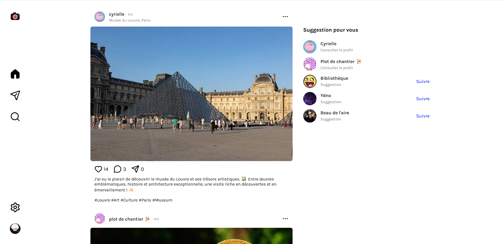

# SnapFace
Interface web de réseau social inspirée d'Instagram, développée avec Angular dans le cadre d'une certification Angular obtenue en **octobre 2026**.

## ✨ Présentation
**SnapFace** est un projet frontend réalisé dans le cadre de ma certification Angular.

L'objectif du projet était de concevoir une interface moderne et interactive reprenant les principaux codes visuels d'un réseau social tel qu'Instagram, avec une expérience pensée principalement pour une utilisation **sur ordinateur**.

Le projet se concentre sur la **conception de l'interface utilisateur**, la mise en pratique d'Angular et la création de composants réutilisables.

> ℹ️ **Projet frontend uniquement**  
> SnapFace ne dispose ni de backend ni d'API. Les données affichées dans l'application sont donc statiques ou simulées côté frontend.

## 🎯 Objectifs
Ce projet m'a permis de mettre en pratique plusieurs concepts fondamentaux d'Angular :
- Concevoir une application Angular complète
- Structurer une interface en composants réutilisables
- Manipuler les propriétés et événements Angular
- Gérer des états d'interface
- Mettre en place une navigation entre les différentes vues
- Créer des interactions utilisateur
- Organiser proprement le code frontend
- Mettre en application les bonnes pratiques Angular

## 🖥️ Fonctionnalités
- Fil d'actualité
- Publications
- Likes
- Messagerie
- Profil utilisateur
- Navigation entre les différentes pages

## 🛠️ Technologies

<p>
  
</p>

## 🏗️ Architecture

### Architecture initiale

L'application était initialement organisée autour de dossiers regroupant les composants, modèles, services et pages. Cette structure permettait de séparer les responsabilités tout en conservant une organisation simple.

```text
src/
├── app/
│   ├── components/
│   ├── models/
│   ├── pages/
│   └── services/
├── index.html
├── main.ts
└── styles.scss
```

### Évolution vers une architecture par fonctionnalités

Au fil du développement, l'organisation a évolué vers une architecture orientée fonctionnalités (*feature-based*). L'objectif était de regrouper les éléments liés à un même domaine fonctionnel afin de faciliter la maintenance et l'évolution de l'application.

```text
src/app/
├── features/
│   ├── snaps/
│   │   ├── components/
│   │   ├── models/
│   │   ├── services/
│   │   └── pages/
│   ├── messages/
│   ├── profil/
│   └── search/
└── layout/
    └── sidebar/
```

Cette évolution permet de mieux isoler les fonctionnalités et de regrouper leurs composants, modèles et services respectifs. Les éléments transverses, comme la barre latérale, restent dans un dossier dédié au layout.

---

## 🚀 Installation
### Prérequis
- Node.js
- Angular CLI

### Installation
```bash
git clone https://github.com/VincentDiribarne/Snapface.git
cd snapface
npm install
```

### Lancement
```bash
ng serve
```

L'application est ensuite accessible à l'adresse `http://localhost:4200`.

## Aperçu
### Accueil


### Messages
<!-- Ajouter une capture d'écran -->

### Autres interfaces
<!-- Ajouter une capture d'écran -->

## 📈 Évolutions possibles
Le projet pourrait être complété par un backend afin de rendre l'application réellement fonctionnelle :

- Mise en place d'une API REST
- Gestion des utilisateurs et de l'authentification
- Persistance des publications, likes et commentaires
- Gestion de l'ajout d'images
- Système de notifications
- Messagerie privée fonctionnelle

## 👨‍💻 Auteur
Vincent DIRIBARNE

Projet réalisé dans le cadre de la certification Angular sans IA — **Octobre 2026**.

## 📄 Licence
Ce projet est un projet personnel réalisé à des fins d'apprentissage et de démonstration.
